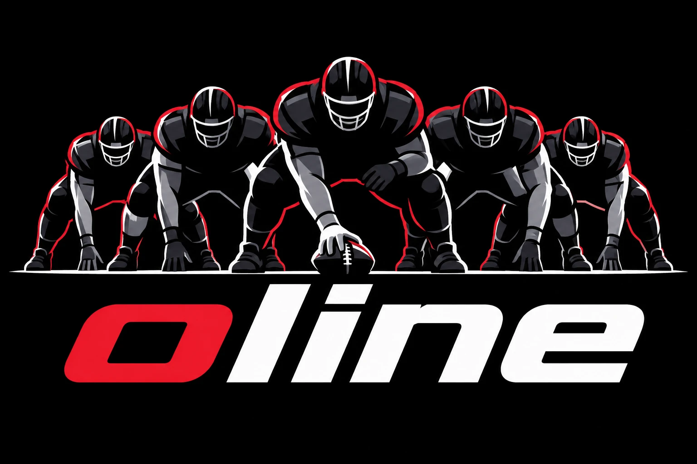

# Offensive Line

<p align="center">
  
</p>

**Offensive Line**: A Go program that runs an "offensive line" of AI agents
inside an isolated sandbox that coordinates an attack against an authorized
target.

Two modes:

- **Pentester**: Run a penetration test against a network using AI agents.
- **Exploiter**: Develop fully-weaponized exploits using AI agents.

> **Authorized use only.** Run oline only against systems you own or have written
> permission to test. The author is not responsible for illegal use.

## Documentation

- [Getting started](docs/getting-started.md): build, API key, running, and flags.
- [The interface](docs/tui.md): the setup wizard, the running view, and keybindings.
- [Agents, modes, and tools](docs/agents.md): the rosters, tools, and time budgets.
- [Configuration](docs/configuration.md): config files, models, secrets, backups, and logs.
- [Sandbox and egress](docs/sandbox.md): the WSL and QEMU backends and the network boundary.

## Build

Requires Go 1.27 or newer.

```bash
go build ./cmd/oline      # or: make build
go test ./...
make dist                 # cross-compiled binaries into the project root (or: pwsh ./build.ps1)
```

## Run

```bash
oline -mode pentester     # launch the TUI with the setup wizard
oline -mode exploiter
oline -edit               # open the model/provider editor and exit
oline -init-config        # write the mode's default config and prompts to ~/oline/config/<mode>/
oline -print              # print the resolved roster and exit
oline -version
```

Skip the wizard and start directly:

```bash
oline -mode pentester -env <wsl-distro> -scope "10.0.0.5, 10.0.0.0/24" -goal "prove RCE" [-manual]
```

On the first run, the setup wizard asks for your OpenAI-compatible provider (name, base URL, API
key, and a model per tier); see [Getting started](docs/getting-started.md).
